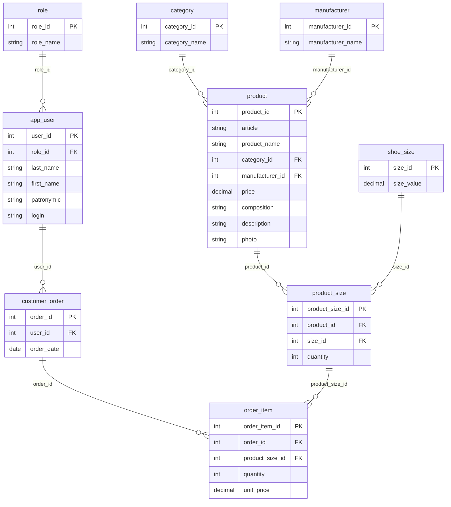

# ООО «Обувь» — система оформления заказов

Настольное приложение для выбора обуви из каталога и оформления заказов.
Стек: Python 3.10, PyQt5, PostgreSQL.

## Возможности

**Все пользователи (включая гостя)**
- Каталог моделей обуви: фото (или заглушка), категория, наименование, производство, состав, цена со скидкой, наличие («много» — больше 5 пар, «мало» — 5 и меньше).
- Товары, у которых осталось 3 пары и меньше (по всем размерам), подсвечиваются светло-красным.
- Скидка 25% на модели, по которым не было заказов в предыдущем календарном месяце. Старая цена показывается зачёркнутой.

**Авторизованный пользователь** (вход только по логину, без пароля; ФИО и роль в правом верхнем углу)
- Поиск по наименованию и описанию, фильтр по категории («Все категории» сбрасывает фильтр), сортировка по цене. Всё применяется сразу и вместе.
- Карточка товара: все данные, размерный ряд, доступные размеры с остатком, выбор количества.
- Корзина: добавление нескольких позиций, удаление позиции, отказ от заказа, подтверждение. При подтверждении остатки списываются в одной транзакции с сохранением заказа.

**Менеджер и Администратор**
- Список заказов: номер, дата, ФИО клиента, число позиций, сумма.
- Новый заказ на выбранного клиента: выбор товара в каталоге с поиском, затем карточка с размером и количеством.
- Просмотр состава заказа: модель, производство, размер, количество, цена за единицу, итоговая сумма.
- Удаление заказа (товары возвращаются на склад).

**Только Администратор**
- Редактирование заказа: изменение даты, удаление товарных позиций (с возвратом на склад).

Навигация последовательная: у каждой страницы свой заголовок, кнопка «Назад» возвращает на предыдущую страницу. Ошибки ввода и необратимые действия сопровождаются сообщениями с нужной пиктограммой.

## Запуск

```bash
python -m venv .venv
.venv\Scripts\pip install -r requirements.txt
createdb -U postgres shoe_shop
psql -U postgres -d shoe_shop -f database/create_db.sql
psql -U postgres -d shoe_shop -f database/seed_data.sql
.venv\Scripts\python main.py
```

Подключение к БД настраивается в `config.ini`. Тестовые логины: `admin`, `manager`, `client1`, `client2`, `client3`.

Сборка exe: `build_exe.bat` (результат в `dist\ShoeShop`).

## Структура

| Путь | Назначение |
|---|---|
| `main.py` | Точка входа, перехват необработанных ошибок |
| `main_window.py` | Шапка и стек страниц с историей для «Назад» |
| `pages/` | Страницы: вход, каталог, карточка, корзина, заказы, состав заказа |
| `repository.py` | SQL-запросы |
| `pricing.py` | Алгоритм скидки и правила остатков |
| `style.py` | Цвета, шрифты, таблица стилей |
| `database/` | Скрипт структуры БД и тестовые данные |
| `tools/import_data.py` | Импорт товаров из CSV заказчика |
| `resources/` | Логотип, иконка, заглушка, фото товаров |

## Схема БД


